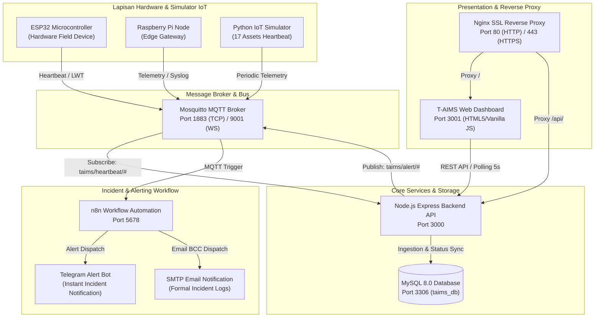

# T-AIMS (Teknolab Asset & Infrastructure Monitoring System)

[]()
[]()
[]()
[]()

**T-AIMS** adalah sistem pemantauan aset infrastruktur IT terpusat, cerdas, dan waktu-nyata (*real-time*) yang dikembangkan untuk **PT Teknolab Caraka Internasional**. Sistem ini mengintegrasikan sensor IoT lapangan, protokol MQTT, backend REST API, database relasional terverifikasi, otomatisasi notifikasi insiden via n8n (Telegram & Email), serta antarmuka visual dashboard interaktif untuk memitigasi downtime infrastruktur.

---

## 1. Arsitektur Sistem & Aliran Data

Sistem T-AIMS dibangun berdasarkan prinsip modularitas dan redundansi berstandar industri:



---

## 2. Matriks Port & Layanan Infrastruktur

| Layanan | Protokol / Port | Status Dev | Deskripsi Peran |
| :--- | :--- | :--- | :--- |
| **MySQL Database** | TCP / `3306` | AKTIF | Penyimpanan relasional 8 tabel baku (`taims_db`) |
| **Mosquitto MQTT** | TCP / `1883`, `9001` | AKTIF | Broker pesan real-time untuk heartbeat & incident alert |
| **Backend API** | HTTP / `3000` | AKTIF | REST API Node.js Express, otentikasi JWT & MQTT listener |
| **Frontend Web** | HTTP / `3001` | AKTIF | Antarmuka monitoring real-time, donut chart, 17 aset E2E |
| **n8n Automation** | HTTP / `5678` | AKTIF | Engine workflow notifikasi Telegram & SMTP Email |
| **Nginx Reverse Proxy** | HTTPS / `443` | Siap Deploy | Reverse proxy SSL termination & security hardening |

---

## 3. Struktur Tim Proyek & Pembagian Tugas (11 Anggota Sesuai Dokumen PKL Teknolab)

Proyek dijalankan oleh 11 personel yang terbagi ke dalam 2 shift operasional:

### Shift 1 (07.00 WIB – 16.00 WIB) — 5 Peserta
* **Fokus**: System Core, Backend, Database, Hardware Integration, dan Network Monitoring.
1. **Damar Munajad**: Project Coordinator & System Analyst
2. **Ahmad Reza Fahmi**: Backend & API Developer
3. **Faida Trisma Amelia**: Database & Asset Management Engineer
4. **Ilvina Muvarika**: IoT & Device Integration Engineer
5. **Ananda Dwi Susanti**: Network & Device Monitoring Engineer

### Shift 2 (16.00 WIB – 01.00 WIB) — 6 Peserta
* **Fokus**: Integration, Dashboard, Visualization, Automation, Deployment, Testing, dan Documentation.
1. **Dzakwan**: Shift Lead & System Integration
2. **Dika Yoga**: Frontend Dashboard Developer
3. **Ahmad Aziz**: UI/UX & Data Visualization Engineer
4. **Arik**: Automation & Notification Engineer
5. **Wafian**: DevOps, Server & Security Engineer (Penanggung Jawab Infrastruktur & Keamanan)
6. **Reza Tri**: QA, Testing & Documentation Engineer

---

## 4. Prasyarat Environment (System Prerequisites)

Untuk menjalankan seluruh ekosistem T-AIMS, pastikan lingkungan host atau server memenuhi spesifikasi berikut:

* **Sistem Operasi**: Linux (Ubuntu 22.04 LTS / Debian 12) atau Windows 10/11 dengan WSL2.
* **Node.js**: Versi `18.x` atau `20.x` LTS (disertai `npm`).
* **Python**: Versi `3.9+` (diperlukan modul `paho-mqtt` untuk simulator & skrip verifikasi).
* **Database**: MySQL `8.0` atau MariaDB `10.5+` (Port `3306`).
* **Message Broker**: Eclipse Mosquitto `2.0+` (Port `1883` & `9001`).
* **Docker Engine & Docker Compose**: Versi `24.0+` & Docker Compose v2 (untuk kontainerisasi penuh).
* **Web Server**: Nginx `1.22+` (untuk konfigurasi reverse proxy SSL/HTTPS).

---

## 5. Panduan Menjalankan Layanan (Quick Start)

### Opsi 1: Menjalankan di Lingkungan Lokal (Windows / XAMPP / WSL)
1. **Database**: Aktifkan MySQL via XAMPP Control Panel (Port 3306).
2. **Broker MQTT & n8n**: Jalankan container via Docker:
   ```bash
   docker start taims-mosquitto taims-n8n
   ```
3. **Backend & Frontend**: Jalankan skrip launcher terintegrasi:
   ```bat
   devops\scripts\start_services.bat
   ```
   Pilih opsi `[3]` untuk menyalakan Backend (Port 3000) dan Frontend (Port 3001) secara bersamaan.

### Opsi 2: Full-Stack Docker Deployment
Untuk menyalakan seluruh 5 layanan dalam satu perintah terisolasi:
```bash
docker compose up -d --build
```
Untuk menghentikan:
```bash
docker compose down
```

---

## 6. Prosedur Pencadangan Database (Backup & Recovery)

Pencadangan database dilakukan secara otomatis menggunakan skrip portabel dinamis:
```bash
# Jalankan pencadangan database
bash devops/scripts/backup_db.sh
```
* File backup tersimpan di `database/backups/taims_db_backup_YYYYMMDD_HHMMSS.sql`.
* Skrip secara otomatis menghapus file pencadangan yang berusia lebih dari 7 hari (*log rotation*).

---

## 7. Uji Simulasi Kegagalan (Failure & Recovery Verification)

Sesuai panduan operasional PKL, sistem telah melewati pengujian 6 skenario kegagalan:
1. **Pemutusan Koneksi Simulator/ESP32**: Mendeteksi status `offline` dalam waktu 60 detik melalui LWT / timeout checker.
2. **Koneksi Ulang Perangkat**: Mendeteksi status `online` kembali (*auto-recovery*) dan memicu notifikasi recovery.
3. **Kesiapsiagaan Docker Container**: Restart kebijakan `unless-stopped` memastikan broker dan automation bangkit secara otomatis pasca reboot.

---

## 8. Kebijakan Keamanan & Tata Kelola Repositori
* **Kredensial**: File `.env` tidak pernah dikomit ke repositori publik.
* **Autentikasi Form**: Form login frontend memvalidasi respons API backend secara ketat tanpa bypass lokal.
* **MQTT Auth**: Konfigurasi broker mengaktifkan `allow_anonymous false` dengan otentikasi user `taims-broker`.
* **Daily Handover**: Seluruh berkas serah terima tugas harian 11 personel tim terdokumentasi terpadu di [`docs/handover/`](docs/handover/).