# Matriks Integrasi Infrastruktur & Keterhubungan Tim (11 Personel)
**Sistem:** T-AIMS (*Teknolab Asset & Infrastructure Monitoring System*)  
**Penanggung Jawab:** Wafian (*DevOps, Server & Security Engineer - Shift 2*)  
**Pembaruan Terakhir:** 16 Oktober 2026  
**Status Integrasi:** 100% Terhubung & Tervalidasi

---

## Ikhtisar Keterhubungan Peran DevOps dengan 11 Anggota Tim

Sesuai Panduan Operasional PKL PT Teknolab Caraka Internasional, peran **DevOps, Server & Security Engineer** berfungsi sebagai tulang punggung integrasi infrastruktur yang menghubungkan seluruh keluaran teknis 11 anggota tim (Shift 1 & Shift 2):

```mermaid
graph TD
    WAF["Wafian (DevOps & Security)<br/>Pusat Infrastruktur & Keamanan"]

    %% Shift 1 Connections
    DAMAR["1. Damar Munajad<br/>(Project Coordinator & Analyst)"]
    REZA["2. Ahmad Reza Fahmi<br/>(Backend & API)"]
    FAIDA["3. Faida Trisma Amelia<br/>(Database & Asset)"]
    ILVINA["4. Ilvina Ramadhani<br/>(IoT & Embedded)"]
    IQBAL["5. Iqbal Setya Nugraha<br/>(Automation Workflow)"]
    KARISMA["6. Karisma Rahmatika<br/>(Frontend UI/UX)"]

    %% Shift 2 Connections
    DZAKWAN["7. Naufal Dzakwan Ramadhan<br/>(Integration Lead)"]
    ARICK["8. Muhammad Fahmi Arick<br/>(Automation & Alerting)"]
    HAIDAR["9. Haidar Zaki<br/>(Frontend Developer)"]
    AKMAL["10. Akmal Bayu Pratama<br/>(Network & Hardware)"]
    REZATRI["11. Reza Tri Wardana<br/>(QA & Documentation)"]

    %% Edges
    WAF <==>|Arsitektur & Uji 6 Skenario| DAMAR
    WAF <==>|Node.js Port 3000 & Dockerfile| REZA
    WAF <==>|MySQL 3306 & backup_db.sh| FAIDA
    WAF <==>|Mosquitto 1883 & LWT Offline| ILVINA
    WAF <==>|n8n Docker Port 5678| IQBAL
    WAF <==>|Nginx Alpine Port 3001| KARISMA
    WAF <==>|verify_integration.py & Guide| DZAKWAN
    WAF <==>|Telegram & SMTP Gmail Alert| ARICK
    WAF <==>|E2E 16 Aset Live & Anti-Bypass| HAIDAR
    WAF <==>|Systemd Daemon Monitoring| AKMAL
    WAF <==>|Konsolidasi Handover & Evidence| REZATRI
```

---

## Rincian Titik Sambung Teknis Per Anggota Tim

### 1. Damar Munajad — Project Coordinator & System Analyst (Shift 1)
* **Keluaran Damar**: Requirement Document, Desain Arsitektur, Block Diagram, DFD, Integration Checklist.
* **Integrasi oleh Wafian**:
  * Mengintegrasikan seluruh dokumen keluaran Damar ke repositori utama di `docs/system-analyst/`.
  * Mengadopsi diagram blok arsitektur Damar ke dalam master `README.md` (Mermaid Data Flow).
  * Menyusun dan memvalidasi skrip otomatis ketahanan sistem terhadap 6 skenario kegagalan (`devops/scripts/test_failure_simulation.sh`) sesuai Hal 17 buku panduan PKL.

### 2. Ahmad Reza Fahmi — Backend & API Developer (Shift 1)
* **Keluaran Reza**: REST API Express.js (Port 3000), otentikasi JWT, penanganan payload MQTT.
* **Integrasi oleh Wafian**:
  * Menyiapkan kontainerisasi Dockerfile resmi (`taims-backend/Dockerfile`).
  * Menyediakan skrip startup portabel (`devops/scripts/start_services.bat`) dengan deteksi dinamis.
  * Menyelaraskan variabel environment (`.env.example`) dan routing API di balik reverse proxy Nginx.

### 3. Faida Trisma Amelia — Database & Asset Management Engineer (Shift 1)
* **Keluaran Faida**: Skema relasional 7 tabel basis data `taims_db` dan registry 16 aset resmi.
* **Integrasi oleh Wafian**:
  * Membuat skrip pencadangan otomatis portabel (`devops/scripts/backup_db.sh`) dengan kebijakan retensi 7 hari.
  * Menormalisasi berkas dokumentasi database dari ekstensi `.md.txt` menjadi `.md` murni di `database/docs/`.
  * Mengorkestrasikan container `taims-mysql` lengkap dengan mekanisme *healthcheck* otomatis di `docker-compose.yml`.

### 4. Ilvina Ramadhani — IoT & Embedded Systems Engineer (Shift 1)
* **Keluaran Ilvina**: Firmware ESP32 C++, Raspberry Pi, topik `taims/heartbeat/#`, dan status LWT `offline`.
* **Integrasi oleh Wafian**:
  * Mengonfigurasi broker Mosquitto Port 1883 dengan mode *Dual-Auth* (`allow_anonymous true` untuk kemudahan pengujian hardware lapangan + file otentikasi `passwd` untuk keamanan produksi).
  * Menyelaraskan parameter koneksi pada skrip simulator dan edge heartbeat.

### 5. Iqbal Setya Nugraha — Automation & Workflow Specialist (Shift 1)
* **Keluaran Iqbal**: Fondasi awal workflow n8n dan integrasi trigger Telegram.
* **Integrasi oleh Wafian**:
  * Mengorkestrasikan kontainer Docker `taims-n8n` pada Port 5678 dengan volume persistent `taims_n8n_data`.
  * Memastikan kontinuitas workflow saat kontainer di-restart atau dipindahkan lingkungan.

### 6. Karisma Rahmatika — Frontend & UI/UX Designer (Shift 1)
* **Keluaran Karisma**: Desain tampilan monitoring, tata letak kartu aset, dan styling CSS.
* **Integrasi oleh Wafian**:
  * Membuat `frontend/Dockerfile` berbasis Nginx Alpine ringan untuk melayani antarmuka web pada Port 3001.
  * Membersihkan 11 file controller backend yang salah tempat di folder frontend guna menjaga higienitas arsitektur.

### 7. Wafian Zaidan El Y. — DevOps, Server & Security Engineer (Shift 2)
* **Peran Inti**: Penanggung jawab keandalan server, otomasi kontainerisasi 5 layanan, keamanan jaringan, mitigasi celah akses, dan operator utama kesiapan sistem (*Merge Phase*).

### 8. Naufal Dzakwan Ramadhan — Integration & Data Flow Engineer (Shift 2 Lead)
* **Keluaran Dzakwan**: Master health checker `verify_integration.py` v1.3 dan panduan integrasi tim.
* **Integrasi oleh Wafian**:
  * Menyelaraskan seluruh parameter sistem pada `ENVIRONMENT.md` dan `INTEGRATION_GUIDE.md` hingga mencapai kelulusan **15/15 OK (100% HIJAU)**.
  * Bertindak sebagai **Operator Utama** yang mengendalikan seluruh service (MySQL, Mosquitto, API, UI, n8n) saat evaluasi Merge Phase berlangsung.

### 9. Muhammad Fahmi Arick — Automation, Alerting & Quality Engineer (Shift 2)
* **Keluaran Arick**: Pembaruan workflow n8n (notifikasi ganda Telegram + Email SMTP Gmail dengan jeda 10 menit).
* **Integrasi oleh Wafian**:
  * Memverifikasi kredensial SMTP Gmail (`education8420@gmail.com` dengan App Password `sydnaxxyqkdzypge`).
  * Menambahkan node `Send an Email` pada workflow `MQTT T-AIMS OFFLINE` dan `MQTT T-AIMS RECOVERY`.
  * Menguji live trigger via MQTT publish dan memvalidasi respon Google Mail Server (`250 2.0.0 OK`).

### 10. Haidar Zaki — Frontend & UI/UX Developer (Shift 2)
* **Keluaran Haidar**: Integrasi frontend live ke backend API, rendering dinamis 16 aset, live polling 5 detik.
* **Integrasi oleh Wafian**:
  * Memperbaiki bug kalkulasi KPI availability (konversi tipe data integer).
  * Menutup celah keamanan otentikasi bypass pada `frontend/index.html` dan menghapus password hardcoded.
  * Memastikan sinkronisasi data 16 aset database tersaji real-time di UI.

### 11. Reza Tri Wardana — QA & Documentation Engineer (Shift 2)
* **Keluaran Reza Tri**: Test plan, test cases, bukti pengujian 58 endpoint, pelacakan bug.
* **Integrasi oleh Wafian**:
  * Mengonsolidasikan seluruh berkas serah terima harian (*Daily Handover*) dari `docs/qa/handover/` ke direktori terpadu `docs/handover/`.
  * Menyediakan berkas log pengujian dan SOP recovery resmi di `docs/recovery.md`.

---

## Status Kesiapan Operasional
Seluruh modul dari 11 anggota tim telah terhubung tanpa konflik dalam satu arsitektur terpadu. Sistem dinyatakan **100% Siap untuk Merge Phase**.
