# Matriks Integrasi Infrastruktur & Keterhubungan Tim (11 Personel Sesuai PDF Teknolab)
**Sistem:** T-AIMS (*Teknolab Asset & Infrastructure Monitoring System*)  
**Penanggung Jawab:** Wafian (*DevOps, Server & Security Engineer - Shift 2*)  
**Pembaruan Terakhir:** 16 Oktober 2026  
**Status Integrasi:** 100% Terhubung & Sesuai Dokumen Resmi PKL Teknolab  

---

## Ikhtisar Keterhubungan Peran DevOps dengan 11 Anggota Tim (Halaman 6 PDF)

Sesuai Dokumen Kerja Praktik Kerja Lapangan PT Teknolab Caraka Internasional (Halaman 6), proyek T-AIMS dikerjakan oleh 11 personel yang terbagi dalam 2 shift:
* **Shift 1 (07.00 WIB – 16.00 WIB)**: 5 Peserta (System Core, Backend, Database, Hardware Integration, dan Network Monitoring)
* **Shift 2 (16.00 WIB – 01.00 WIB)**: 6 Peserta (Integration, Dashboard, Visualization, Automation, Deployment, Testing, dan Documentation)

```mermaid
graph TD
    WAF["5. Wafian (DevOps, Server & Security)<br/>Pusat Infrastruktur, Deployment & Keamanan"]

    %% Shift 1 (5 Peserta)
    subgraph S1 ["Shift 1 (07.00 - 16.00 WIB) - 5 Peserta"]
        DAMAR["1. Damar Munajad<br/>(Project Coordinator & System Analyst)"]
        REZA["2. Ahmad Reza Fahmi<br/>(Backend & API Developer)"]
        FAIDA["3. Faida Trisma Amelia<br/>(Database & Asset Management Engineer)"]
        ILVINA["4. Ilvina Muvarika<br/>(IoT & Device Integration Engineer)"]
        ANANDA["5. Ananda Dwi Susanti<br/>(Network & Device Monitoring Engineer)"]
    end

    %% Shift 2 (6 Peserta)
    subgraph S2 ["Shift 2 (16.00 - 01.00 WIB) - 6 Peserta"]
        DZAKWAN["1. Dzakwan<br/>(Shift Lead & System Integration)"]
        DIKA["2. Dika Yoga<br/>(Frontend Dashboard Developer)"]
        AZIZ["3. Ahmad Aziz<br/>(UI/UX & Data Visualization Engineer)"]
        ARIK["4. Arik<br/>(Automation & Notification Engineer)"]
        REZATRI["6. Reza Tri<br/>(QA, Testing & Documentation Engineer)"]
    end

    %% Hubungan Sisi DevOps (Wafian)
    WAF <==>|Arsitektur, DFD & Uji 6 Skenario| DAMAR
    WAF <==>|Node.js Port 3000 & Dockerfile| REZA
    WAF <==>|MySQL Port 3306 & backup_db.sh| FAIDA
    WAF <==>|Mosquitto Dual-Auth Port 1883| ILVINA
    WAF <==>|Network Engine & Monitoring Daemon| ANANDA
    WAF <==>|verify_integration.py & Merge Runbook| DZAKWAN
    WAF <==>|Nginx Alpine Port 3001 & API Route| DIKA
    WAF <==>|Asset Map, Responsive & Asset Cards| AZIZ
    WAF <==>|n8n Docker 5678, Telegram & SMTP Gmail| ARIK
    WAF <==>|Failure Simulation & Konsolidasi Handover| REZATRI
```

---

## Rincian Titik Sambung Teknis Per Anggota Tim (Sesuai Halaman 6-12 PDF)

### SHIFT 1 (07.00 WIB – 16.00 WIB) — 5 Peserta

#### 1. Damar Munajad — Project Coordinator & System Analyst
* **Output Wajib PDF**: *Requirement Document, System Architecture, Block Diagram, Data Flow, Integration Checklist, Daily Handover.*
* **Integrasi Teknis oleh Wafian**:
  * Mengintegrasikan seluruh dokumen keluaran Damar ke repositori resmi di `docs/system-analyst/`.
  * Mengadopsi diagram blok dan aliran data arsitektur Damar ke dalam master `README.md`.
  * Menyelaraskan dan memvalidasi skrip otomatis ketahanan terhadap 6 skenario kegagalan (`devops/scripts/test_failure_simulation.sh`) sesuai Halaman 17 PDF.

#### 2. Ahmad Reza Fahmi — Backend & API Developer
* **Output Wajib PDF**: *REST API, Heartbeat Endpoint, Status API, History API, Dashboard Statistics API, API Documentation.*
* **Integrasi Teknis oleh Wafian**:
  * Menyiapkan kontainerisasi Dockerfile resmi (`taims-backend/Dockerfile`) pada Port 3000.
  * Menyediakan skrip startup portabel (`devops/scripts/start_services.bat`) dengan deteksi dinamis.
  * Menyelaraskan variabel environment (`.env.example`) dan routing API di balik reverse proxy Nginx SSL.

#### 3. Faida Trisma Amelia — Database & Asset Management Engineer
* **Output Wajib PDF**: *Database Schema, Migration / SQL, Asset Registry, Backup Procedure, Database Documentation.*
* **Integrasi Teknis oleh Wafian**:
  * Menyiapkan skrip pencadangan otomatis portabel (`devops/scripts/backup_db.sh`) dengan kebijakan retensi 7 hari.
  * Menjamin konsistensi relasional 7 tabel baku dan perbaikan seed akun pengguna pada `database/taims_db.sql`.
  * Mengorkestrasikan kontainer `taims-mysql` lengkap dengan mekanisme *healthcheck* otomatis pada `docker-compose.yml`.

#### 4. Ilvina Muvarika — IoT & Device Integration Engineer
* **Output Wajib PDF**: *Firmware / Agent, Heartbeat Function, MQTT/HTTP Integration, Reconnect Logic, Test Result.*
* **Integrasi Teknis oleh Wafian**:
  * Mengonfigurasi broker Eclipse Mosquitto Port 1883 dengan mode *Dual-Auth* (`allow_anonymous true` untuk kemudahan pengujian hardware lapangan ESP32/RPi + file kredensial `passwd` untuk keamanan produksi).
  * Menyelaraskan parameter koneksi MQTT topic `taims/heartbeat/#` dan status LWT `offline`.

#### 5. Ananda Dwi Susanti — Network & Device Monitoring Engineer
* **Output Wajib PDF**: *Monitoring Engine, Device Check Rules, Retry Logic, Response Time, Network Monitoring Test.*
* **Integrasi Teknis oleh Wafian**:
  * Menyediakan lingkungan runtime stabil untuk mesin monitoring berkala perangkat jaringan (Ping, HTTP, TCP, SNMP, MQTT).
  * Mengintegrasikan service daemon pengawas (`taims-monitoring.service`) berbasis systemd untuk memastikan kontinuitas evaluasi status aset.

---

### SHIFT 2 (16.00 WIB – 01.00 WIB) — 6 Peserta

#### 1. Dzakwan — Shift Lead & System Integration
* **Output Wajib PDF**: *Integration Checklist, Bug List, Dependency List, Release Record, Daily Handover.*
* **Integrasi Teknis oleh Wafian**:
  * Menyelaraskan seluruh parameter infrastruktur pada `ENVIRONMENT.md` dan `INTEGRATION_GUIDE.md` hingga mencapai kelulusan master checker `verify_integration.py` (15/15 OK).
  * Menyiapkan runbook kesiapan operator merge phase (`devops/scripts/runbook_merge_phase.sh`) dan symlink cepat `~/runbook.sh`.

#### 2. Dika Yoga — Frontend Dashboard Developer
* **Output Wajib PDF**: *Dashboard, Device List, Device Detail, Filter, History View, API Integration.*
* **Integrasi Teknis oleh Wafian**:
  * Menyediakan kontainerisasi frontend Nginx Alpine ringan (`frontend/Dockerfile`) pada Port 3001.
  * Memperbaiki logika kalkulasi KPI availability pada script frontend dan menghubungkan live endpoint backend.

#### 3. Ahmad Aziz — UI/UX & Data Visualization Engineer
* **Output Wajib PDF**: *UI Design, Chart & Visualization, Location Map / Floorplan, Status Component, Responsive Layout.*
* **Integrasi Teknis oleh Wafian**:
  * Mengonfigurasi header keamanan Nginx (CSP, X-Frame-Options) agar komponen visualisasi peta dan chart interaktif ter-render mulus di desktop maupun mobile.
  * Memastikan aset visual dan layout CSS tidak mengalami kendala *mixed-content* di bawah protokol HTTPS.

#### 4. Arik — Automation & Notification Engineer
* **Output Wajib PDF**: *Offline Alert, Recovery Alert, n8n Workflow, AI Analysis, Telegram / Email Output.*
* **Integrasi Teknis oleh Wafian**:
  * Mengorkestrasikan kontainer Docker `taims-n8n` pada Port 5678 dengan volume persistent `taims_n8n_data`.
  * Memvalidasi pengiriman notifikasi ganda Telegram dan SMTP Gmail (`education8420@gmail.com`) dengan status sukses `250 2.0.0 OK`.

#### 5. Wafian — DevOps, Server & Security Engineer
* **Output Wajib PDF**: *Production Deployment, SSL, Environment Configuration, Backup, Service Log, Security Checklist.*
* **Tanggung Jawab Inti**:
  * Menyiapkan orkestrasi kontainer penuh (Docker Compose 5 service: MySQL, Mosquitto, Backend, Frontend, n8n).
  * Mengonfigurasi reverse proxy SSL/TLS (`devops/nginx/nginx.conf`), skrip setup SSL otomatis, dan manajemen secret `.env`.
  * Menjamin otomatisasi rotasi backup database 7 hari, logging terpusat, dan ketahanan sistem terhadap 6 skenario kegagalan.

#### 6. Reza Tri — QA, Testing & Documentation Engineer
* **Output Wajib PDF**: *Test Report, Bug Report, User Manual, Technical Documentation, Video Demo, Final Evidence.*
* **Integrasi Teknis oleh Wafian**:
  * Mengonsolidasikan seluruh berkas serah terima harian (*Daily Handover*) ke direktori terpusat `docs/handover/`.
  * Menyediakan berkas log pengujian kegagalan (`devops/logs/`) dan SOP pemulihan sistem (`docs/recovery.md`) sebagai bukti verifikasi teknis.

---

## Status Kesiapan Operasional
Seluruh modul dari 11 anggota tim sesuai Dokumen Operasional PKL PT Teknolab Caraka Internasional telah terintegrasi tanpa tumpang tindih. Sistem dinyatakan **100% Siap untuk Merge Phase**.
