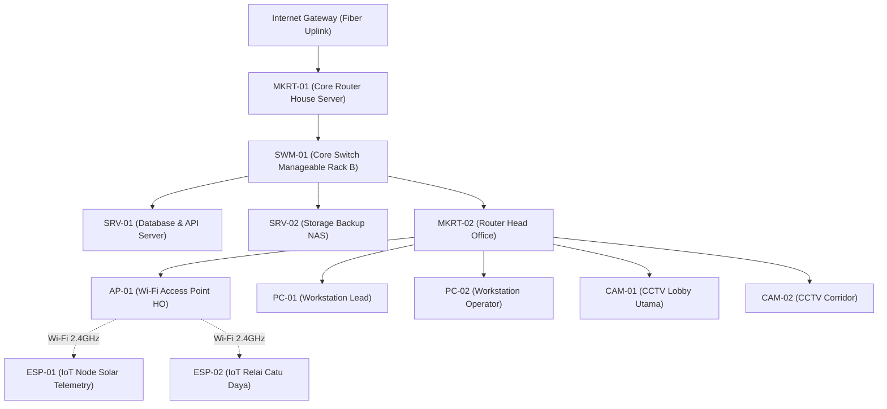

# T-AIMS | Network Topology & Root Cause Analysis (RCA)
**PT Teknolab Caraka Internasional • Enterprise Monitoring System**  
*Dokumentasi Arsitektur Standar SRE & AIOps (Checklist Hari 21)*

---

## 1. Topologi Jaringan & Pohon Dependensi (Parent-Child Hierarchy)

Sistem T-AIMS membagi infrastruktur ke dalam hierarki pohon dependensi untuk mencegah fenomena **Alert Storm (Banjir Notifikasi)**:

---

## 2. Logika Pencegahan Alert Storm (Cascade Downstream Suppression)

Jika perangkat **Parent Link** (seperti `SWM-01` atau `MKRT-01`) terdeteksi putus (`OFFLINE`):
1. **Root Cause Isolation:** Daemon background mengidentifikasi bahwa induk jalur transmisi sedang mati.
2. **Cascade Tagging:** Perangkat turunan (*downstream*) seperti CCTV, PC, dan Access Point diberi label `[CASCADE DOWNSTREAM]` secara otomatis.
3. **Agregasi Notifikasi:** Bot Telegram dan Email Alert menyajikan 1 ringkasan utama bahwa insiden berpusat pada Core Switch, bukan 10 perangkat independen yang mati bersamaan.
4. **Hasil:** Teknisi NOC tidak mengalami *alert fatigue* dan langsung fokus pada perbaikan catu daya/kabel uplink `SWM-01`.
