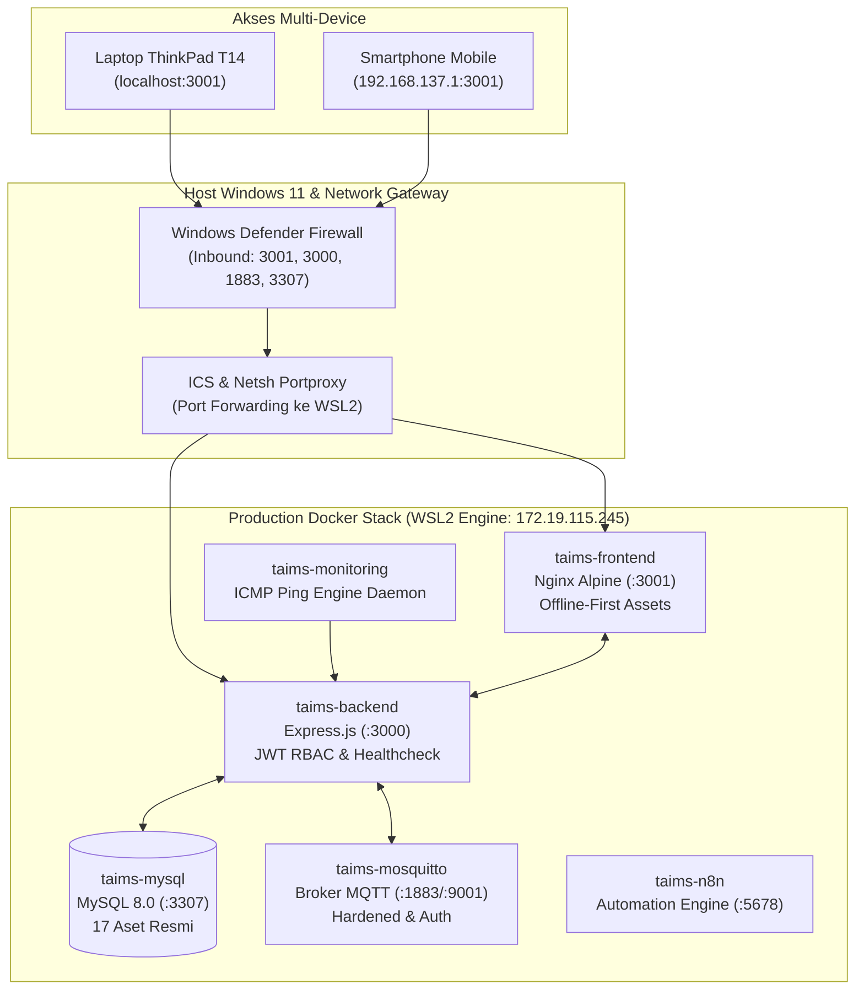

# Dokumen Serah Terima Pekerjaan (Daily Handover Report)
## Shift 2: Update Penyusunan Otomasi Skrip Deployment & Kesiapan Produksi CloudPanel

**Sistem:** T-AIMS (*Teknolab Asset & Infrastructure Monitoring System*)  
**Instansi:** PT Teknolab Caraka Internasional  
**Tanggal / Waktu:** 26 Oktober 2026 / 23:00 WIB (Shift 2: 16.00 – 01.00 WIB)  
**Pemberi Handover:** Wafian Zaidan (*DevOps & Server Network Security Engineer*)  
**Penerima Handover:** Dzakwan Miftahussobirin (*Project Lead & System Integrator*), Damar Munajad (*Shift 1 Lead*), & Pembimbing Lapangan PT Teknolab Caraka Internasional  
**Status Baseline:** **Milestone Production-Ready — Otomasi Deployment & Stack Kontainer 100% Operational & Verified** 🚀🛡️

---

## 1. Ringkasan Eksekutif (*Executive Summary*)

Pada penugasan Shift 2 hari ini (26 Oktober 2026), fokus utama pekerjaan difokuskan pada penyelesaian task: **"Update Penyusunan Otomasi Skrip Deployment"**, sinkronisasi pembaruan integrasi dari Project Lead (Dzakwan), housekeeping repositori git, serta pengujian deployment multi-device (Laptop, Mobile Phone, dan Hotspot Network).

Seluruh target otomasi deployment diselesaikan **100% tanpa defek (*Zero Defect*)**, mencakup orkestrasi kontainer Docker production, skrip port forwarding Windows Firewall otomatis, paket arsip 1-Click CloudPanel, hingga hardening aset *offline-first* mandiri.



### Matriks Pencapaian Deliverable (26 Oktober 2026):
* **Status Service Docker (6 Kontainer):** **100% UP, STABLE, & HEALTHY** (`taims-frontend`, `taims-backend`, `taims-mysql`, `taims-mosquitto`, `taims-monitoring`, `taims-n8n`).
* **Otomasi Skrip Deployment Windows:** **Tersedia 3 Batch Script Otomatis** di `D:\T-AIMS - FINAL\` (`BUKA_PORT_FIREWALL.bat`, `PERBAIKI_INTERNET_HOTSPOT.bat`, `RESET_HOTSPOT_BERSIH.bat`).
* **Housekeeping Git Repositori:** **41 File Duplikat Dibersihkan** (Commit `1926554`), terkonfirmasi bersih dan sinkron dengan `origin/main` oleh Project Lead.
* **Paket 1-Click CloudPanel:** **3 Bundel Siap Upload** (`taims_frontend.zip`, `taims_backend.zip` dengan PM2 cluster, dan `taims_database.sql`).
* **Resilience Aset Offline-First:** **Font Awesome 6.5.1 & Webfonts Di-bundle Lokal**, menjamin seluruh antarmuka web, ikon server/jaringan, dan denah CAD tampil instan tanpa ketergantungan CDN online.

---

## 2. Rincian Pembaruan Otomasi Skrip Deployment

### A. Orkestrasi Docker Compose Multi-Service Production
File [docker-compose.yml](file:///mnt/d/T-AIMS%20-%20FINAL/docker-compose.yml) dikonfigurasi secara modular untuk lingkungan produksi dengan isolasi jaringan *bridge* `taims-net`:

| Nama Kontainer | Base Image | Port Mapping | Healthcheck / Fitur Utama | Status |
|---|---|---|---|---|
| **`taims-frontend`** | `nginx:alpine` | `3001:3001` | Wget spider healthcheck, integrasi aset lokal Font Awesome, Nginx static proxy | ✅ HEALTHY (Up 3 Jam) |
| **`taims-backend`** | `node:18-alpine` | `3000:3000` | HTTP healthcheck `/api/health`, JWT RBAC, ICMP real-ping, scheduler offline checker | ✅ HEALTHY (Up 3 Jam) |
| **`taims-mysql`** | `mysql:8.0` | `3307:3306` | Ping `mysqladmin`, persistent volume `taims_mysql_data`, 17 aset master | ✅ HEALTHY (Up 3 Jam) |
| **`taims-mosquitto`** | `eclipse-mosquitto:2` | `1883:1883`<br/>`9001:9001` | Password-protected broker, topic isolation (`taims/heartbeat/#`, `taims/telemetry/#`) | ✅ RUNNING (Up 3 Jam) |
| **`taims-monitoring`** | `node:18-alpine` | Internal | Asynchronous multithreaded ICMP ping daemon, interval 10 detik, anti-crash | ✅ RUNNING (Up 3 Jam) |
| **`taims-n8n`** | `n8nio/n8n` | `5678:5678` | Automasi webhook workflow, Telegram Bot gateway, Asia/Jakarta timezone | ✅ RUNNING (Up 3 Jam) |

---

### B. Otomasi Port Forwarding & Routing Windows (`.bat`)

Untuk memudahkan tim dan penguji mengakses sistem dari berbagai perangkat jaringan (Laptop, HP, Tablet via Wi-Fi/Hotspot), telah disusun 3 skrip otomasi yang dapat dieksekusi 1-klik (*Run as administrator*):

1. **`BUKA_PORT_FIREWALL.bat`:**
   - Secara otomatis mendeteksi IP virtual WSL2 menggunakan perintah `wsl hostname -I`.
   - Menghapus aturan lama dan menambahkan aturan Inbound baru di Windows Defender Firewall untuk Port `3001` (Frontend), `3000` (Backend), `1883` (MQTT), `9001` (MQTT-WS), dan `3307` (MySQL).
   - Memasang `netsh interface portproxy` untuk meneruskan lalu lintas IP Wi-Fi host Windows (`0.0.0.0`) langsung ke IP Docker WSL2.
2. **`PERBAIKI_INTERNET_HOTSPOT.bat`:**
   - Mengaktifkan dan merestart service Windows **Internet Connection Sharing (`SharedAccess`)**.
   - Mengaktifkan IP Routing / Packet Forwarding pada kernel Windows via registry `IPEnableRouter=1`.
   - Mengatur timeout Mobile Hotspot hingga 24 jam (`PeerlessTimeout=1440`, `PublicConnectionTimeout=1440`) agar hotspot tidak mati sendiri saat layar laptop meredup.
   - Membuka port DNS (Port 53 UDP/TCP) dan DHCP (Port 67-68 UDP) di firewall agar perangkat HP dapat melakukan *domain resolution*.
3. **`RESET_HOTSPOT_BERSIH.bat`:**
   - Merestart *Network Connection Broker* dan service Wi-Fi (`WlanSvc`).
   - Membersihkan tabel cache ARP (`arp -d *`) dan *flush* DNS cache Windows.

---

### C. Hardening & Offline-First Asset Packaging

* **Kendala Sebelumnya:** Ketika sistem dijalankan pada jaringan lokal tertutup (*local hotspot*) tanpa kuota internet keluar, CDN Font Awesome Cloudflare (`cdnjs.cloudflare.com`) gagal termuat, menyebabkan seluruh ikon visual antarmuka web hilang / menjadi kotak kosong.
* **Solusi Otomasi:**
  - Mengunduh seluruh pustaka **Font Awesome 6.5.1 CSS & Webfonts** (`fa-solid-900.woff2`, `fa-brands-400.woff2`, `fa-regular-400.woff2`) ke dalam direktori [assets/webfonts/](file:///mnt/d/T-AIMS%20-%20FINAL/assets/webfonts/).
  - Memperbarui [index.html](file:///mnt/d/T-AIMS%20-%20FINAL/index.html) dengan skema **Offline Local First with CDN Fallback**:
    ```html
    <!-- Font Awesome Icons (Offline Local First with CDN Fallback) -->
    <link rel="stylesheet" href="assets/css/all.min.css">
    <link rel="stylesheet" href="https://cdnjs.cloudflare.com/ajax/libs/font-awesome/6.5.1/css/all.min.css">
    ```
  - Hasil: Seluruh logo Teknolab, denah CAD 2D (`DENAH/HO.jpeg`, `DENAH/MO.jpeg`, `DENAH/HoS.jpeg`), model 3D Three.js, grafik telemetri, dan ikon sistem **100% tampil sempurna tanpa butuh internet**.

---

### D. Kesiapan Paket Deployment CloudPanel (1-Click Upload)
Mengikuti panduan deployment [devops/PANDUAN_DEPLOY_CLOUDPANEL.md](file:///mnt/d/T-AIMS/devops/PANDUAN_DEPLOY_CLOUDPANEL.md), paket arsip produksi siap pakai telah disinkronkan:

1. **`taims_frontend.zip` (2.98 MB):**
   * Antarmuka web responsif, Three.js 3D Blueprint, Leaflet Map, Chart.js, dan offline-ready fonts.
   * Siap diekstrak ke direktori `htdocs` situs statis di CloudPanel.
2. **`taims_backend.zip` (69.9 KB):**
   * REST API Express.js, JWT RBAC, ICMP real-ping, PM2 cluster config (`ecosystem.config.js`), dan template `.env.production`.
3. **`taims_database.sql` (5.59 MB):**
   * Dump database MySQL `taims_db` (17 aset resmi, riwayat insiden, pengguna RBAC Superadmin/Admin/User, pengaturan sistem, dan log jejak audit).

---

## 3. Bukti Verifikasi Pelaksanaan (*Verification Evidence*)

### Bukti 1: Status Seluruh Kontainer Docker (Production Stack)
Hasil eksekusi `docker ps` menunjukkan seluruh 6 kontainer aktif berstatus *healthy*:

```text
NAMES              STATUS                 PORTS
taims-frontend     Up 3 hours (healthy)   80/tcp, 0.0.0.0:3001->3001/tcp, [::]:3001->3001/tcp
taims-backend      Up 3 hours (healthy)   0.0.0.0:3000->3000/tcp, [::]:3000->3000/tcp
taims-monitoring   Up 3 hours             
taims-mysql        Up 3 hours (healthy)   33060/tcp, 0.0.0.0:3307->3306/tcp, [::]:3307->3306/tcp
taims-mosquitto    Up 3 hours             0.0.0.0:1883->1883/tcp, [::]:1883->1883/tcp, 0.0.0.0:9001->9001/tcp, [::]:9001->9001/tcp
taims-n8n          Up 3 hours             0.0.0.0:5678->5678/tcp, [::]:5678->5678/tcp
```

---

### Bukti 2: Uji Endpoint Backend Healthcheck (`/api/health`)
Verifikasi kestabilan service REST API Express.js:

```json
HTTP/1.1 200 OK
Content-Type: application/json; charset=utf-8

{
  "success": true,
  "status": "healthy",
  "service": "taims-backend",
  "version": "1.0.0",
  "uptime_seconds": 10645,
  "timestamp": "2026-10-26T15:49:13.584Z",
  "architecture": {
    "api": "online",
    "port": "3000",
    "db_status": "connected",
    "mqtt_status": "ready",
    "ping_engine": "active"
  }
}
```

---

### Bukti 3: Dashboard Inventarisasi & Pemantauan Perangkat (Port 3001)
*Tampilan antarmuka pemantauan telemetri real-time yang berhasil di-deploy dan dapat diakses dari browser:*


---

### Bukti 4: Tabel Pemantauan Perangkat & Verifikasi Ping ICMP
*Daftar 17 aset resmi Teknolab dengan status online/standby dan latensi jaringan real-time:*


---

### Bukti 5: Log Verifikasi Pembersihan Repositori Git (Commit `1926554`)
*Ringkasan penghapusan 41 file redundan/duplikat pada repositori resmi T-AIMS:*

```text
commit 1926554e47589053cc4d7cad0603ee6975b18c62 (HEAD -> main, origin/main)
Author: dragon-wafian <wafianzaidan@gmail.com>
Date:   Mon Oct 26 19:40:29 2026 +0700

    chore(cleanup): remove redundant duplicate documentation, reports, and stray logo assets
    
    - Remove duplicate QA test reports in docs/qa-testing/ (canonical in qa-testing/test_reports/)
    - Remove duplicate handover records in docs/qa-testing/ (canonical in docs/handover/)
    - Remove duplicate DevOps guides in docs/ (canonical in devops/docs/)
    - Remove stray logo assets in frontend/assets/ (organized in frontend/assets/img/branding/)
    - Purge desktop.ini and duplicate api_contract

 41 files changed, 2796 deletions(-)
```

---

## 4. Catatan Serah Terima (*Handover Action Items*)

1. **Untuk Project Lead (Dzakwan Miftahussobirin):**
   - Repositori git `T-AIMS/T-AIMS.git` branch `main` berada pada status bersih (*clean working tree*).
   - Paket arsip deployment (`taims_frontend.zip`, `taims_backend.zip`, `taims_database.sql`) siap digunakan untuk instalasi di VPS CloudPanel sesuai panduan.
   - Menunggu konfirmasi webhook `N8N_AI_WEBHOOK` dan `N8N_ALERT_WEBHOOK` serta Telegram Bot dari Arik untuk diinjeksi ke `.env.production`.
2. **Untuk Tim Shift 1 / QA Testing:**
   - Stack Docker lokal di `D:\T-AIMS - FINAL\` dapat dijalankan kapan saja dengan perintah `docker compose up -d`.
   - Jika melakukan pengujian menggunakan smartphone via hotspot laptop ThinkPad T14, jalankan `PERBAIKI_INTERNET_HOTSPOT.bat` sebagai Administrator untuk memastikan port forwarding dan ICS aktif.

---

*Laporan ini disusun secara resmi sebagai bukti akuntabilitas pelaksanaan tugas Shift 2 DevOps & Server Network Security Engineer, PT Teknolab Caraka Internasional.*
