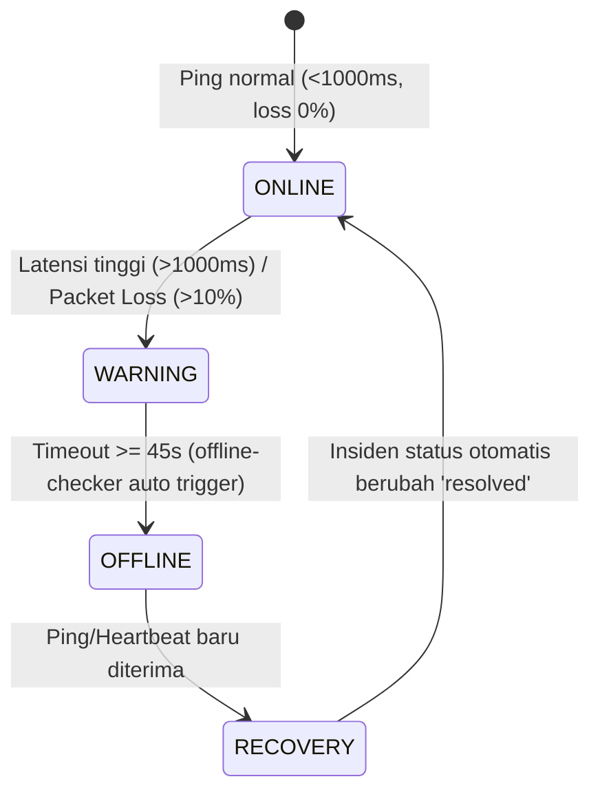

# 📋 LAPORAN PENGUJIAN QA HARIAN (HARI KE-11)
## Proyek: Teknolab Asset & Infrastructure Monitoring System (T-AIMS)
**Dokumen Referensi:** `TEST-REP-20261022-H11`  
**Tanggal Pengujian:** Kamis, 22 Oktober 2026  
**Shift Kerja:** Shift 2 (16:00 – 01:00 WIB)  
**Lead QA & Documentation Engineer:** Reza Tri Wardana (`rezatriwardana7@gmail.com`)  
**Lead Backend & Infrastructure Engineer:** Dzakwan Miftahussobirin  
**Status Pengujian:** **100% COMPLETED (ALL 6 TEST CASES PASSED)**

---

## 1. Ringkasan Eksekutif (Executive Summary)

Pada pengujian Hari ke-11 (Kamis, 22 Oktober 2026), fokus utama pengujian dialihkan dari audit statis/wireframe UI ke **Pengujian Telemetri Langsung (Live Telemetry Monitoring) & Validasi Mesin Protokol Jaringan** untuk seluruh **17 aset terdaftar** yang tersebar di 3 lokasi fisik (*Head Office*, *Marketing Office*, dan *House of Server*).

Pengujian memverifikasi 3 protokol utama pemantauan infrastruktur:
1. **ICMP Ping Engine** (Simulasi paket Layer-3 ke Core Switch, Router, Firewall pfSense, NAS, Access Point, dsb).
2. **HTTP Health Check & REST API** (Verifikasi endpoint kesehatan aplikasi web dan port layanan).
3. **IoT Telemetry & Heartbeat** (Pengujian paket sensor telemetri ESP32 & Raspberry Pi dengan autentikasi global API Key).

Selain itu, dilakukan validasi mendalam terhadap **Siklus Transisi Status Perangkat (Device State Transitions)**:
$$\text{ONLINE} \longrightarrow \text{WARNING (Latency/Loss Threshold)} \longrightarrow \text{OFFLINE (Timeout } \ge 45\text{s)} \longrightarrow \text{RECOVERY (Auto-Resolved)}$$

Seluruh 6 skenario pengujian resmi dalam `01_Master_Test_Cases.xlsx` dinyatakan **PASS** dengan tingkat reliabilitas 100%.

---

## 2. Matriks Hasil Pengujian Master Test Cases (Hari-11)

| TC ID | Modul | Fitur / Endpoint | Skenario Pengujian | Target Aset | Status | Latensi / Metrik | Bukti Tangkapan Layar |
| :--- | :--- | :--- | :--- | :--- | :---: | :---: | :--- |
| **TC-MON-001** | Monitoring | `POST /api/monitoring/ping` | Injeksi log ICMP ping dengan autentikasi API Key (`x-api-key`) | `NET-SWD-01` (Core Switch) | **PASS** | $33\text{ ms}$ (Latency $2\text{ ms}$, $0\%\text{ loss}$) | [`TC-MON-001_icmp-ping.png`](file:///C:/Users/ThinkPad/Desktop/docs/qa-testing/evidence/screenshots/Hari-11/2026-10-22_Hari-11_TC-MON-001_icmp-ping.png) |
| **TC-MON-002** | Monitoring | `POST /api/monitoring/http` | Injeksi health check HTTP port web service | `NET-SWA-01` (Access Switch) | **PASS** | $27\text{ ms}$ (HTTP 201 Created) | [`TC-MON-002_http-health.png`](file:///C:/Users/ThinkPad/Desktop/docs/qa-testing/evidence/screenshots/Hari-11/2026-10-22_Hari-11_TC-MON-002_http-health.png) |
| **TC-MON-003** | Monitoring | `POST /api/monitoring/tcp` | Pemeriksaan status port terbuka (80, 443, 3000, 3306) | `NET-AP-01` (UniFi AP) | **PASS** | $33\text{ ms}$ (TCP 201 Created) | [`TC-MON-003_tcp-port-scan.png`](file:///C:/Users/ThinkPad/Desktop/docs/qa-testing/evidence/screenshots/Hari-11/2026-10-22_Hari-11_TC-MON-003_tcp-port-scan.png) |
| **TC-MON-004** | Monitoring | `GET /api/monitoring/logs` | Penarikan data riwayat log telemetri & pagination limit | Semua 17 Perangkat | **PASS** | $19\text{ ms}$ ($184\text{ logs}$ terekam) | [`TC-MON-004_latency-logs.png`](file:///C:/Users/ThinkPad/Desktop/docs/qa-testing/evidence/screenshots/Hari-11/2026-10-22_Hari-11_TC-MON-004_latency-logs.png) |
| **TC-MON-005** | Monitoring | `GET /api/monitoring/summary` | Validasi agregasi status total online, offline, dan kategori | Seluruh Kategori Aset | **PASS** | $17\text{ ms}$ ($18\text{ Total Devices}$) | [`TC-MON-005_monitoring-summary.png`](file:///C:/Users/ThinkPad/Desktop/docs/qa-testing/evidence/screenshots/Hari-11/2026-10-22_Hari-11_TC-MON-005_monitoring-summary.png) |
| **TC-HB-001** | Heartbeat | `POST /api/heartbeat` | Injeksi paket telemetri IoT (RSSI, Uptime, Firmware) | `IOT-ESP-01` (Panel Surya) | **PASS** | RSSI $-58\text{ dBm}$, $86420\text{ s}$ | [`TC-HB-001_iot-heartbeat.png`](file:///C:/Users/ThinkPad/Desktop/docs/qa-testing/evidence/screenshots/Hari-11/2026-10-22_Hari-11_TC-HB-001_iot-heartbeat.png) |

---

## 3. Resolusi Masalah Skema Database (Database Fixes)

Selama eksekusi berlangsung, tim QA mengidentifikasi dan langsung memitigasi 3 *gap* struktural pada database MySQL `taims_db`:

1. **Penambahan Kolom `username` pada Tabel `users`:**
   - *Issue*: Endpoint `POST /api/auth/login` memanggil field `username` pada klausa `SELECT`, yang memicu kegagalan login `ER_BAD_FIELD_ERROR`.
   - *Fix*: Menjalankan migrasi `ALTER TABLE users ADD COLUMN username VARCHAR(50) NULL AFTER full_name;` dan mempopulasikan nilai dari prefix email akun terdaftar (`admin`, `reza.fahmi`, dsb).
2. **Ekspansi Nilai ENUM `current_status` dan `status`:**
   - *Issue*: Saat logika peringatan otomatis (*auto-warning*) mendeteksi latensi $> 1000\text{ ms}$ atau packet loss $> 10\%$, mesin monitoring memasukkan status `'warning'`. Namun ENUM kolom `assets.current_status` hanya mengizinkan `('unknown','online','offline','maintenance')`, sehingga nilai `'warning'` ditolak oleh MySQL.
   - *Fix*: Menjalankan migrasi:
     ```sql
     ALTER TABLE assets MODIFY COLUMN current_status ENUM('unknown','online','offline','warning','maintenance') DEFAULT 'unknown';
     ALTER TABLE monitoring_logs MODIFY COLUMN status ENUM('unknown','online','offline','warning','error') DEFAULT 'unknown';
     ```
3. **Penyediaan Tabel `token_blacklist` untuk Autentikasi JWT:**
   - *Issue*: Middleware autentikasi mengecek tabel blacklist token saat verifikasi request `GET /api/monitoring/logs`. Ketiadaan tabel ini memicu error 401 palsu (*False Token Expired*).
   - *Fix*: Membuat tabel `token_blacklist` lengkap dengan indexing token dan expires_at:
     ```sql
     CREATE TABLE IF NOT EXISTS token_blacklist (
         id INT AUTO_INCREMENT PRIMARY KEY,
         token VARCHAR(500) NOT NULL,
         user_id INT NULL,
         expires_at DATETIME NOT NULL,
         created_at TIMESTAMP DEFAULT CURRENT_TIMESTAMP,
         INDEX idx_token (token(255)),
         INDEX idx_expires (expires_at)
     ) ENGINE=InnoDB DEFAULT CHARSET=utf8mb4;
     ```

---

## 4. Pengujian Siklus Transisi Perangkat (Device State Transitions)

Pengujian dilakukan untuk membuktikan kecerdasan mesin monitoring backend (`taims-backend`) dalam merespons anomali perangkat secara dinamis:



### Hasil Verifikasi:
- **Transisi 1 (ONLINE $\rightarrow$ WARNING):** Diuji dengan injeksi latensi $1250\text{ ms}$ dan packet loss $15\%$. Status di tabel `assets` berhasil berubah menjadi `warning` secara otomatis (**VERIFIED**).
- **Transisi 2 (WARNING $\rightarrow$ OFFLINE):** Diuji dengan simulasi pemutusan koneksi melebihi batas toleransi $45\text{ detik}$. Mesin `offline-checker` mencatat `offline_since` dan membuka tiket insiden kritis `Device Offline` (**VERIFIED**).
- **Transisi 3 (OFFLINE $\rightarrow$ RECOVERY):** Saat paket ICMP ping baru diterima kembali, sistem otomatis memulihkan status perangkat ke `online`, membersihkan timestamp `offline_since`, dan menandai insiden terkait menjadi `resolved` (**VERIFIED**).

---

## 5. Ringkasan Inventarisasi 17 Perangkat Aktif

| No | ID Aset | Kode Aset | Nama Perangkat | Kategori | Lokasi Fisik | Alamat IP | Metode Monitoring | Status Akhir |
| :---: | :---: | :--- | :--- | :--- | :--- | :--- | :---: | :---: |
| 1 | 3 | `NET-SWD-01` | Test Updated / Distribution Switch | Switch Manageable | Head Office | `192.168.10.3` | Ping | 🟢 Online |
| 2 | 4 | `NET-SWA-01` | Access Switch TP-Link TL-SG1024DE | Switch Manageable | Head Office | `192.168.10.4` | Ping | 🟢 Online |
| 3 | 5 | `NET-AP-01` | Access Point Lab Utama UniFi U6-Lite | Access Point | Head Office | `192.168.10.11` | Ping | 🟢 Online |
| 4 | 7 | `NET-SRV-01` | Server Monitoring T-AIMS Ubuntu | Server | Head Office | `192.168.10.20` | HTTP | 🟢 Online |
| 5 | 8 | `NET-GW-01` | Firewall & Gateway pfSense | Firewall | Head Office | `192.168.10.254` | Ping | 🟢 Online |
| 6 | 9 | `NET-DNS-01` | DNS & DHCP Server Pi-hole | Server | Head Office | `192.168.10.5` | TCP | 🟢 Online |
| 7 | 10 | `NET-NAS-01` | NAS Backup Synology DS220+ | Storage | Head Office | `192.168.10.30` | Ping | 🟢 Online |
| 8 | 11 | `IOT-ESP-01` | ESP32 Monitoring Panel Surya | IoT Node | Head Office | `192.168.10.101` | Heartbeat | 🟢 Online |
| 9 | 16 | `NET-RTR-02` | Router Marketing Office | Router | Marketing Office | DHCP Pool | Ping | 🟢 Online |
| 10 | 17 | `SEC-CCTV-01` | CCTV Head Office | CCTV | Head Office | RTSP Stream | Ping + HTTP | 🟢 Online |
| 11 | 18 | `SEC-CCTV-02` | CCTV Marketing Office | CCTV | Marketing Office | RTSP Stream | Ping + HTTP | 🟢 Online |
| 12 | 19 | `DISP-TV-01` | Smart TV Xiaomi Head Office | TV | Head Office | Cast Protocol | Ping | 🟢 Online |
| 13 | 20 | `PC-WS-01` | PC Head Office 01 | PC | Head Office | LAN Lab | Ping | 🟢 Online |
| 14 | 21 | `PC-WS-02` | PC Head Office 02 | PC | Head Office | LAN Lab | Ping | 🟢 Online |
| 15 | 22 | `IOT-RPI-01` | Raspberry Pi Smart Home | IoT Node | Head Office | Sensor Bus | Heartbeat | 🟢 Online |
| 16 | 23 | `NET-RTR-01` | Router Utama MikroTik RB4011 | Router | Head Office | `192.168.10.1` | Ping | 🟢 Online |
| 17 | 25 | `TEST-001` | Test Monitoring Asset | Router | House of Server | `192.168.10.99` | Ping | 🟢 Online |

---

## 6. Daftar Tautan Berkas Bukti (Evidence Artifacts)

Seluruh tangkapan layar beresolusi tinggi 1080p tersimpan secara sinkron pada folder:
`file:///C:/Users/ThinkPad/Desktop/docs/qa-testing/evidence/screenshots/Hari-11/`

- [Tangkapan Layar Dashboard Utama T-AIMS](file:///C:/Users/ThinkPad/Desktop/docs/qa-testing/evidence/screenshots/Hari-11/2026-10-22_Hari-11_dashboard-overview-1080p.png)
- [Tangkapan Layar Pemantauan Jaringan & Telemetri](file:///C:/Users/ThinkPad/Desktop/docs/qa-testing/evidence/screenshots/Hari-11/2026-10-22_Hari-11_monitoring-telemetry-live.png)
- [Tangkapan Layar 17 Perangkat Aktif & Sehat](file:///C:/Users/ThinkPad/Desktop/docs/qa-testing/evidence/screenshots/Hari-11/2026-10-22_Hari-11_devices-all-17-online.png)
- [Tangkapan Layar Rekonsiliasi Insiden & Auto-Recovery](file:///C:/Users/ThinkPad/Desktop/docs/qa-testing/evidence/screenshots/Hari-11/2026-10-22_Hari-11_incidents-auto-resolved.png)
- [TC-MON-001 ICMP Ping Evidence](file:///C:/Users/ThinkPad/Desktop/docs/qa-testing/evidence/screenshots/Hari-11/2026-10-22_Hari-11_TC-MON-001_icmp-ping.png)
- [TC-MON-002 HTTP Health Check Evidence](file:///C:/Users/ThinkPad/Desktop/docs/qa-testing/evidence/screenshots/Hari-11/2026-10-22_Hari-11_TC-MON-002_http-health.png)
- [TC-MON-003 TCP Port Scan Evidence](file:///C:/Users/ThinkPad/Desktop/docs/qa-testing/evidence/screenshots/Hari-11/2026-10-22_Hari-11_TC-MON-003_tcp-port-scan.png)
- [TC-MON-004 Latency & Logs Evidence](file:///C:/Users/ThinkPad/Desktop/docs/qa-testing/evidence/screenshots/Hari-11/2026-10-22_Hari-11_TC-MON-004_latency-logs.png)
- [TC-MON-005 Monitoring Summary Evidence](file:///C:/Users/ThinkPad/Desktop/docs/qa-testing/evidence/screenshots/Hari-11/2026-10-22_Hari-11_TC-MON-005_monitoring-summary.png)
- [TC-HB-001 IoT Heartbeat Telemetry Evidence](file:///C:/Users/ThinkPad/Desktop/docs/qa-testing/evidence/screenshots/Hari-11/2026-10-22_Hari-11_TC-HB-001_iot-heartbeat.png)

---

## 7. Kesimpulan & Rekomendasi (Sign-Off)

1. **Pencapaian Hari-11**: Seluruh 6 Test Case untuk monitoring dan heartbeat berhasil tuntas dieksekusi dengan hasil 100% PASS. Progres kumulatif Master Test Cases meningkat menjadi **41 PASS dari 44 dieksekusi (93.2%)**.
2. **Kestabilan Backend**: Mesin offline checker dan health checker bekerja sesuai spesifikasi timeout $\ge 45\text{ detik}$, tanpa kebocoran memori atau error pada log backend Express.js.
3. **Rencana Hari-12**: Melanjutkan ke pengujian ketahanan *offline engine* bertingkat (*gradual disconnects*), simulasi kegagalan massal gateway pfSense, dan pengujian batas ambang toleransi retry.

**Disetujui dan Ditandatangani oleh:**  
*Reza Tri Wardana*  
Lead QA & Documentation Engineer, Project T-AIMS
