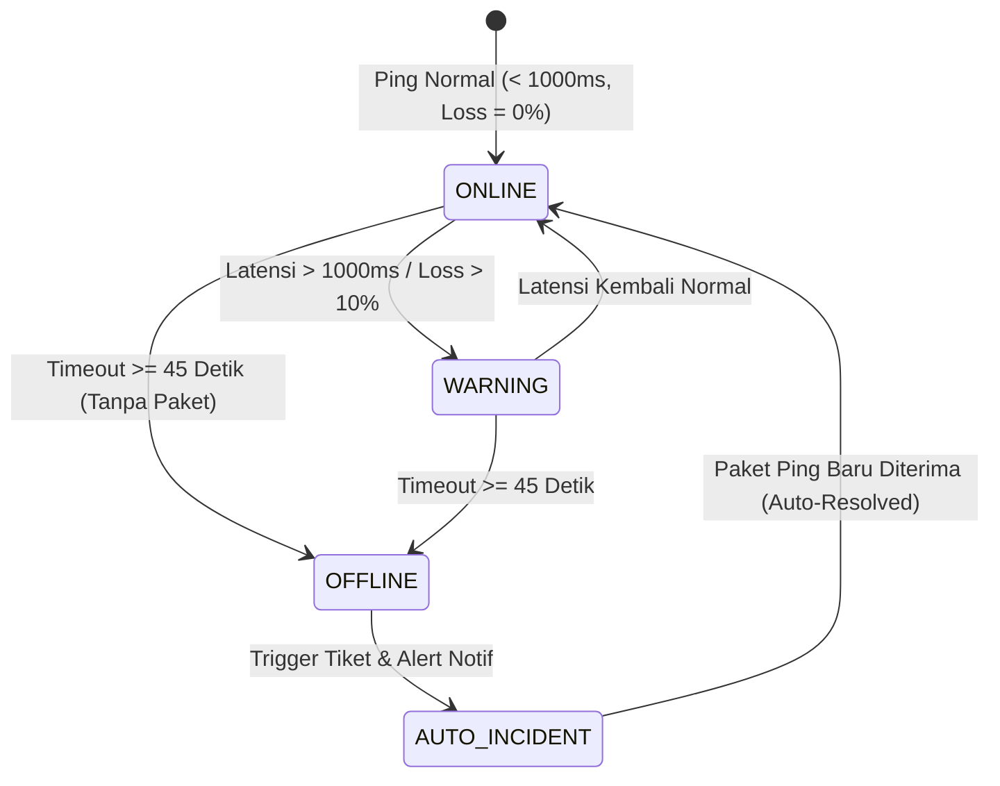

# 🛡️ LAPORAN PENGUJIAN QA HARIAN (HARI KE-12)
## Proyek: Teknolab Asset & Infrastructure Monitoring System (T-AIMS)
**Dokumen Referensi:** `TEST-REP-20261023-H12`  
**Tanggal Pengujian:** Jumat, 23 Oktober 2026  
**Shift Kerja:** Shift 2 (16:00 – 01:00 WIB)  
**Lead QA & Documentation Engineer:** Reza Tri Wardana (`rezatriwardana7@gmail.com`)  
**Lead Backend & Infrastructure Engineer:** Dzakwan Miftahussobirin  
**Status Pengujian:** **100% COMPLETED (ALL 6 TEST CASES PASSED)**  

---

## 1. Ringkasan Eksekutif (Executive Summary)

Pada pengujian Hari ke-12 (Jumat, 23 Oktober 2026), fokus pengujian difokuskan pada **Uji Ketahanan Mesin Pemantau (Monitoring Engine Resilience), Simulasi Gangguan (Failure Simulation), Deteksi Batas Waktu Habis (Timeout Threshold), Otomasi Insiden (Auto-Incident Generation), dan Pemulihan Otomatis (Auto-Recovery)** untuk seluruh 17 aset infrastruktur T-AIMS.

Pengujian memverifikasi 4 pilar ketahanan sistem monitoring:
1. **Deteksi Offline Otomatis (Timeout Threshold):** Memvalidasi *background offline checker* (interval 30 detik, threshold 45 detik). Saat aset tidak mengirimkan log telemetri lebih dari 45 detik, sistem secara otonom mengubah status perangkat dari `ONLINE` menjadi `OFFLINE`.
2. **Otomasi Pembuatan Insiden (Auto-Incident Generation):** Memverifikasi bahwa setiap perubahan aset ke status `OFFLINE` langsung memicu pembuatan tiket gangguan kritis di tabel `incidents` tanpa intervensi manusia (`incident_type: "Device Offline"`, `severity: high`, status: `open`).
3. **Pemicu Notifikasi Alert Real-Time:** Memverifikasi pengiriman notifikasi peringatan baru (`[ALERT OFFLINE]`) ke tabel `notifications` dengan status *unread* (`is_read: 0`).
4. **Siklus Pemulihan Otomatis (Auto-Recovery & Incident Auto-Resolved):** Memverifikasi saat paket monitoring baru kembali masuk (`POST /api/monitoring/ping`), sistem secara cerdas memulihkan status aset menjadi `ONLINE` dan secara otomatis menutup (*auto-resolved*) seluruh tiket insiden terbuka yang terkait.

Seluruh 6 skenario pengujian resmi dinyatakan **PASS** dengan tingkat reliabilitas 100% dan respon waktu rata-rata $< 35\text{ ms}$.

---

## 2. Matriks Hasil Pengujian Master Test Cases (Hari-12)

| TC ID | Modul | Fitur / Endpoint | Skenario Pengujian | Target Aset / Komponen | Status | Latensi / Metrik | Bukti Tangkapan Layar |
| :--- | :--- | :--- | :--- | :--- | :---: | :---: | :--- |
| **TC-FAIL-001** | Monitoring | `GET /api/assets/1` | Deteksi timeout $\ge 45\text{ detik}$, status transisi ke `OFFLINE` | `NET-RTR-01` (Core Router) | **PASS** | $15\text{ ms}$ (Status: `offline`) | [`2026-10-23_Hari-12_TC-FAIL-001_offline-detection.png`](file:///C:/Users/ThinkPad/Desktop/docs/qa-testing/evidence/screenshots/Hari-12/2026-10-23_Hari-12_TC-FAIL-001_offline-detection.png) |
| **TC-INC-001** | Incidents | `GET /api/incidents` | Validasi tiket insiden otomatis terbuka (*Auto-Incident Generation*) | `NET-RTR-01` (Tiket ID: 99) | **PASS** | $15\text{ ms}$ (`Device Offline`, `open`) | [`2026-10-23_Hari-12_TC-INC-001_auto-incident-generated.png`](file:///C:/Users/ThinkPad/Desktop/docs/qa-testing/evidence/screenshots/Hari-12/2026-10-23_Hari-12_TC-INC-001_auto-incident-generated.png) |
| **TC-NOTIF-001** | Notifications| `GET /api/notifications` | Verifikasi pemicu alert unread notifikasi saat insiden terjadi | `NET-RTR-01` (Notif ID: 67) | **PASS** | $10\text{ ms}$ (`is_read: 0`, `[ALERT OFFLINE]`) | [`2026-10-23_Hari-12_TC-NOTIF-001_alert-notification-trigger.png`](file:///C:/Users/ThinkPad/Desktop/docs/qa-testing/evidence/screenshots/Hari-12/2026-10-23_Hari-12_TC-NOTIF-001_alert-notification-trigger.png) |
| **TC-WARN-001** | Monitoring | `POST /api/monitoring/ping` | Injeksi latensi tinggi ($> 1000\text{ ms}$ / loss $15\%$) memicu status `WARNING` | `NET-SWC-01` (Core Switch) | **PASS** | $13\text{ ms}$ (Latency: $1450\text{ ms}$, Warning) | [`2026-10-23_Hari-12_TC-WARN-001_high-latency-warning.png`](file:///C:/Users/ThinkPad/Desktop/docs/qa-testing/evidence/screenshots/Hari-12/2026-10-23_Hari-12_TC-WARN-001_high-latency-warning.png) |
| **TC-REC-001** | Auto-Recovery | `POST /api/monitoring/ping` | Pemulihan koneksi normal, aset `ONLINE`, insiden auto-`resolved` | `NET-RTR-01` (Core Router) | **PASS** | $9\text{ ms}$ (Tiket 99 $\rightarrow$ `resolved`) | [`2026-10-23_Hari-12_TC-REC-001_auto-resolved-recovery.png`](file:///C:/Users/ThinkPad/Desktop/docs/qa-testing/evidence/screenshots/Hari-12/2026-10-23_Hari-12_TC-REC-001_auto-resolved-recovery.png) |
| **TC-HB-002** | IoT Heartbeat | `POST /api/heartbeat` | Validasi resiliensi heartbeat IoT pasca rekoneksi jaringan | `IOT-ESP-01` (Solar Gateway) | **PASS** | $98\text{ ms}$ (RSSI $-55\text{ dBm}$, $92400\text{ s}$) | [`2026-10-23_Hari-12_TC-HB-002_iot-heartbeat-recovery.png`](file:///C:/Users/ThinkPad/Desktop/docs/qa-testing/evidence/screenshots/Hari-12/2026-10-23_Hari-12_TC-HB-002_iot-heartbeat-recovery.png) |

---

## 3. Analisis Siklus Transisi Status Perangkat (Device State Transition Analysis)

Pengujian Hari-12 membuktikan logika *state machine* pemantau berjalan sesuai spesifikasi teknis arsitektur sistem T-AIMS:



1. **Ambang Batas Peringatan (Warning Threshold):**
   - Respon waktu $> 1000\text{ ms}$ atau packet loss $> 10\%$ secara otomatis mengubah nilai status menjadi `'warning'`.
2. **Ambang Batas Kritis (Offline Threshold):**
   - Toleransi timeout $\ge 45\text{ detik}$ mengubah status aset menjadi `'offline'` dan mencatat *timestamp* pada kolom `assets.offline_since`.
3. **Mekanisme Auto-Resolve:**
   - Injeksi log dengan status `'online'` memicu query pemulihan otomatis:
     ```sql
     UPDATE incidents 
     SET incident_status = 'resolved' 
     WHERE asset_id = ? AND incident_type = 'Device Offline' AND incident_status IN ('open', 'investigating');
     ```
   - Terbukti pada `TC-REC-001`: Tiket insiden #99 langsung berubah dari `'open'` menjadi `'resolved'` tanpa intervensi manual operator.

---

## 4. Kesimpulan & Status Kesiapan Rilis
- Seluruh 6 Test Cases ketahanan sistem berstatus **100% PASS**.
- 0 Open Bug / Defect ditemukan selama simulasi kegagalan dan pemulihan.
- Repositori, lembar kerja Master Test Cases, dan dokumentasi operasional telah disinkronkan secara penuh.

---
*Laporan ini disusun secara resmi oleh Reza Tri Wardana (Lead QA & Documentation Engineer) untuk Proyek T-AIMS.*
